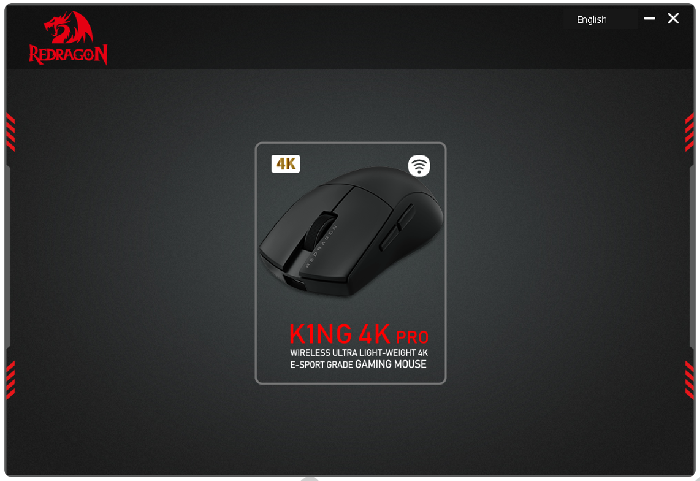

Redragon M916 Pro 4K - Software de configuracion para Linux (Wine)
==================================================================




Este paquete trae el software ya extraido y un script que lo instala en
cualquier Linux x86_64 con Wine. No hace falta ejecutar el instalador .exe
original ni usar innoextract. Además, sí se puede cambiar el idioma a inglés dentro del programa.

REQUISITOS
----------
- Linux x86_64 con sesion grafica (X11 o Wayland).
- Internet (para descargar .NET Framework 4.8, ~100 MB).
- sudo (para instalar dependencias y la regla udev).
- Mouse conectado por el RECEPTOR USB 4K o por CABLE USB-C.
  Por Bluetooth el software NO detecta el mouse.

## INSTALACIÓN

1. Descomprime el paquete:
```bash
tar -xzf Redragon_M916_Pro_4K_Wine.tar.gz
cd Redragon_M916_Pro_4K_Wine
```

2. Ejecuta:
```bash
./install.sh
```

3. Cuando termine, conecta el receptor 4K o el cable y abre:
* Menú de aplicaciones -> **Redragon M916 Pro 4K**
* O en terminal: `redragon-mouse`


QUE HACE install.sh
-------------------
- Instala wine, winetricks, cabextract, wget y una fuente CJK si faltan
  (soporta Arch, Debian/Ubuntu y Fedora).
- Copia la aplicacion a ~/.local/share/redragon-m916
- Crea el prefix Wine en ~/.local/share/wineprefixes/redragon-m916
- Instala .NET Framework 4.8 nativo de Microsoft en el prefix.
  (Wine Mono NO sirve para este software: falla el marshaling de la DLL HID.)
- Crea el lanzador ~/.local/bin/redragon-mouse y la entrada de menu.
- Instala /etc/udev/rules.d/99-redragon-m916.rules para dar acceso HID
  al mouse (Bluetooth F533), al modo cable (F54D) y al receptor 4K (F54F).

SOLUCION DE PROBLEMAS
---------------------
- "This application could not be started" o error de .NET 4.8:
    vuelve a ejecutar ./install.sh con internet.

- La app dice "conecta tu dispositivo":
    usa el receptor 4K o el cable USB-C, no Bluetooth.
    Si ya esta conectado, cierra la app y vuelve a abrirla.

- Se ven cuadros en vez de texto chino:
    falta una fuente CJK. Instala:
      Arch:          sudo pacman -S noto-fonts-cjk
      Debian/Ubuntu: sudo apt install fonts-noto-cjk
      Fedora:        sudo dnf install google-noto-sans-cjk-fonts
    Luego: fc-cache -f

- No abre ninguna ventana:
    ejecutalo desde la sesion grafica, no por SSH.

- El receptor no aparece:
    verifica con: lsusb | grep 3554
    Debe salir "3554:f54f Compx 2.4G Wireless Receiver" (o f54d en modo cable).

DESINSTALAR
-----------
```bash
  rm -rf ~/.local/share/redragon-m916
  rm -rf ~/.local/share/wineprefixes/redragon-m916
  rm -f ~/.local/bin/redragon-mouse
  rm -f ~/.local/share/applications/redragon-mouse.desktop
  sudo rm -f /etc/udev/rules.d/99-redragon-m916.rules
  sudo udevadm control --reload-rules
```
NOTA
----
La interfaz del software viene en chino; es la unica que trae el instalador
original de Redragon. El script instala una fuente CJK para que se lea bien.
